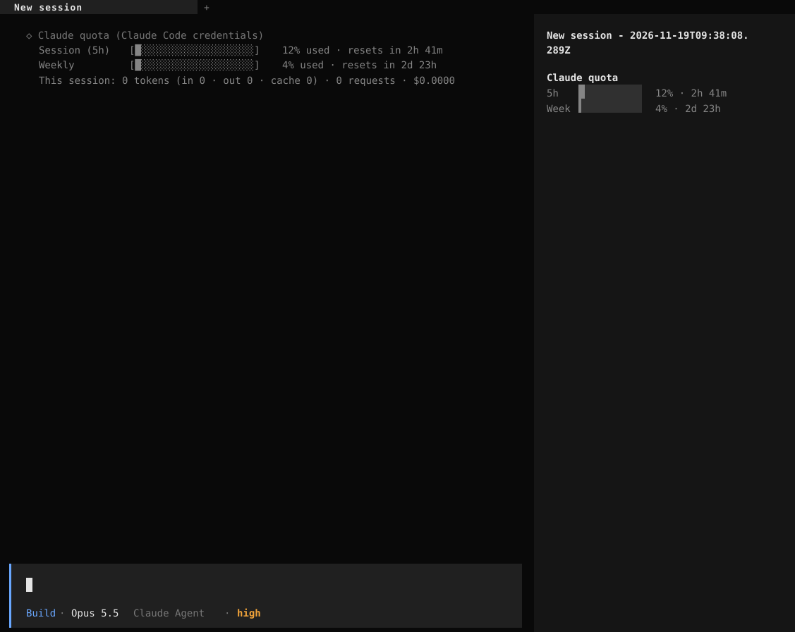

# OpenCode Claude Quota Plugin

An [OpenCode](https://github.com/anomalyco/opencode) plugin that shows your Claude subscription usage in the TUI and reports local token usage for each session.



## Features

- **Live sidebar quota:** session (5-hour) and weekly usage, with progress bars and reset countdowns. Weekly Opus and Sonnet windows are shown when Claude provides them.
- **Provider-aware display:** the sidebar is shown for `anthropic` and `claude-agent` models, and refreshes when you switch to one of them.
- **Refresh and caching:** sidebar data refreshes every minute, after a completed turn, and when the model changes. Results are shared and cached; the plugin avoids repeated API requests. HTTP 429 responses trigger a five-minute backoff.
- **`/quota` command:** displays a compact quota report and this OpenCode session's token and cost counters without requiring an assistant turn.
- **`/quota-reset` command:** clears only the local counters for the current session; it does not change Claude's subscription usage.
- **Model tools:** `quota` returns a detailed report, and `quotaReset` resets local session counters.
- **Credential fallback:** uses OpenCode's active Anthropic OAuth connection, Claude Code credentials, or legacy OpenCode `auth.json` credentials.

Local counters include input, output, reasoning, and cache tokens, request count, elapsed session time, and estimated cost. They are in-memory counters for the current OpenCode process, not Claude's billed usage.

## Requirements

- OpenCode with the plugin API that supports server and TUI plugins.
- A Claude account with OAuth credentials available through OpenCode or Claude Code.
- Node.js 18 or newer to run the installer. OpenCode itself loads the TypeScript plugin files.

## Install

The plugin consists of **all three files in `src/`**. Keep them together in the `claude-quota` plugin directory: `server.ts`, `tui.tsx`, and `rpc.ts`. The server and TUI share the RPC contract through a relative import, so installing only one file (or copying them as a single renamed file) will not work.

### Recommended: installer

Clone the repository and run the installer:

```sh
git clone https://github.com/n00b42/opencode-claude-quota.git
cd opencode-claude-quota
node bin/install.mjs
```

This copies all three source files to:

```text
~/.config/opencode/plugins/claude-quota/
```

To install somewhere else, pass the target plugin directory:

```sh
node bin/install.mjs --dest /path/to/opencode/plugins/claude-quota
```

The installer also honors `OPENCODE_CONFIG_DIR` or `XDG_CONFIG_HOME` when choosing the default configuration directory. You can run `npm run install:local` from the repository as a shortcut.

### Manual install

```sh
mkdir -p ~/.config/opencode/plugins/claude-quota
cp src/server.ts src/tui.tsx src/rpc.ts ~/.config/opencode/plugins/claude-quota/
```

On Windows PowerShell, use the same files and the equivalent directory under your home folder, for example:

```powershell
$plugin = "$HOME\.config\opencode\plugins\claude-quota"
New-Item -ItemType Directory -Force $plugin
Copy-Item src\server.ts, src\tui.tsx, src\rpc.ts $plugin
```

Restart OpenCode after installing or updating the plugin.

## Use

### Sidebar

Select an `anthropic` or `claude-agent` model. The **Claude quota** section appears in the session sidebar when data is available. It shows the 5-hour session and weekly quota, and includes per-model weekly windows when returned by Claude's API. The display is refreshed periodically and after completed turns; a stale-data notice appears if a refresh fails after a successful fetch.

### Slash commands

- `/quota` shows the latest Claude subscription quota and local counters for the current session.
- `/quota-reset` resets the local counters for the current session only.

These commands post the result directly into the session without asking the model to generate a response.

### Assistant tools

When appropriate, the assistant can also call:

| Tool | Purpose |
| --- | --- |
| `quota` | Fetches and formats the Claude quota report, including local session tracking. |
| `quotaReset` | Resets the current session's local token, request, and cost counters. |

## Credentials and privacy

Credentials are checked in this order:

1. OpenCode's active `anthropic` OAuth integration.
2. Claude Code's `~/.claude/.credentials.json` (or `$CLAUDE_CONFIG_DIR/.credentials.json`).
3. Legacy OpenCode `auth.json`, including `$XDG_DATA_HOME/opencode/auth.json`, `~/.local/share/opencode/auth.json`, or the Windows OpenCode data location.

The plugin reads credentials locally and sends the access token to Anthropic's `https://api.anthropic.com/api/oauth/usage` endpoint to retrieve quota. It does not refresh OAuth tokens; start Claude Code or re-authenticate in OpenCode if a token has expired. Local session counters are held in memory and are not written to disk.

## Development and packaging

```sh
npm run install:local  # copy the three plugin files to the default OpenCode plugin directory
node bin/install.mjs --help
```

The npm package metadata exposes `claude-quota-install` as an installer command and includes the `src/` plugin files. The old standalone quota CLI is not part of this plugin installation flow.

Repository layout:

```text
src/
  server.ts   # quota fetching, credentials, commands, tools, session counters, RPC server
  tui.tsx     # sidebar display and refresh behavior
  rpc.ts      # shared RPC contract
bin/
  install.mjs # installs all three source files together
```

## Troubleshooting

- **Sidebar or commands are missing:** confirm all three files are in `~/.config/opencode/plugins/claude-quota/`, then restart OpenCode and check its plugin logs.
- **No credentials found:** log in to Anthropic through OpenCode or Claude Code and confirm Claude Code credentials exist at the configured path.
- **401 or expired token:** restart Claude Code or re-authenticate through OpenCode. This plugin intentionally does not rotate OAuth refresh tokens.
- **Quota is unavailable or stale:** check connectivity to Anthropic's usage endpoint. A 429 response is followed by a five-minute request backoff.
- **Sidebar not visible:** select a model from the `anthropic` or `claude-agent` provider.

## License

MIT
